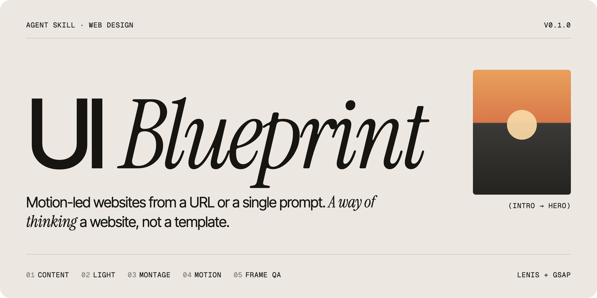

<p align="center">
  
</p>

<p align="center">
  <a href="LICENSE"></a>
  <a href="https://agentskills.io"></a>
  <a href="#installation"></a>
  <a href="https://gsap.com"></a>
  <a href="CHANGELOG.md"></a>
</p>

<p align="center">
  <a href="#installation">Install</a> ·
  <a href="#usage">Usage</a> ·
  <a href="#how-it-works">How it works</a> ·
  <a href="#recipe-library">Recipe library</a> ·
  <a href="#faq">FAQ</a>
</p>

---

**UI Blueprint** is an agent skill that designs and builds motion-led websites at the level of the best references on [details.so](https://www.details.so/inspo): smooth scroll, transitions on scroll and on click, oversized type, cinematic media. Give it the URL of an existing site, or one prompt with a direction and a theme. It goes through content, imagery, storyboard, build and frame-by-frame QA, and delivers a finished site.

It is a way of thinking a website, not a template. Two sites built with it never share the same sequence or the same signature move.

## Why

AI-generated websites tend to look the same: a fade-up on every block, a 0.6 s `ease`, a stock hero, no transitions. The sites people remember work differently. Measured across 44 reference sites, they share seven constants:

| Constant | Seen on |
|---|---|
| Smooth, inertial scroll (Lenis) | 35 / 44 |
| Scroll-driven animation, pinned sections, split text (GSAP + ScrollTrigger) | 32+ / 44 |
| One easing family, almost always *expo out* `cubic-bezier(0.19, 1, 0.22, 1)` | most |
| Display type from 150 to 540 px with tight tracking | most |
| A three-voice type system: workhorse sans, display face, mono for metadata | most |
| Production-grade photo and video | all |
| A choreographed intro of 2 to 4 s that lands exactly on the layout | most |

UI Blueprint turns these into a method, a shared motion vocabulary and a library of tested recipes.

## Features

- **Two entry points.** Redesign an existing site from its URL, or start from a direction-and-theme prompt.
- **Continuity transitions.** Nothing appears out of nowhere: the intro becomes the hero, a thumbnail becomes the detail page, a button becomes the menu.
- **Content-driven motion.** Each piece of content (identity, promise, choice, proof, place, action) gets the motion that expresses it.
- **13 validated recipes, ~20 more in validation.** Each one comes with code, parameters, pitfalls and variants.
- **Frame-by-frame QA.** Playwright contact sheets of the intro, the scroll states and the click sequences, on desktop and mobile.
- **Visitor guardrails.** Plain navigation labels, a call to action always in reach, a short intro, reduced-motion support, a mobile action bar.
- **No fabricated content.** Redesigns reuse the published copy word for word. From-scratch sites keep names, prices, reviews and figures as visible `[placeholders]`.
- **Anti-repetition registry.** Each delivered site is logged, so the next one changes its signature move, type trio and easing family.
- **No build step.** The output is plain HTML, CSS and JS with Lenis and GSAP from a CDN. Inside an existing Next, Nuxt or Astro project, the skill uses the same libraries in the framework.

## Installation

### Quick install (any agent)

With the [skills CLI](https://github.com/vercel-labs/skills), which detects your agents and installs to the right folder:

```bash
npx skills add MartinMrnn/ui-blueprint -g
```

To target one agent, add `-a claude-code`, `-a cursor` or `-a codex`. Drop `-g` to install into the current project only.

### Manual install

<details>
<summary><b>Claude Code</b></summary>

```bash
git clone https://github.com/MartinMrnn/ui-blueprint.git ~/.claude/skills/ui-blueprint
```

For a single project, clone into `.claude/skills/ui-blueprint` at the project root. Claude Code picks the skill up at the next session.
</details>

<details>
<summary><b>Cursor</b></summary>

```bash
git clone https://github.com/MartinMrnn/ui-blueprint.git ~/.cursor/skills/ui-blueprint
```

For a single project, use `.cursor/skills/ui-blueprint`. Cursor also reads `~/.claude/skills` and `~/.agents/skills`, so one install can serve several agents.
</details>

<details>
<summary><b>Codex</b></summary>

```bash
git clone https://github.com/MartinMrnn/ui-blueprint.git ~/.agents/skills/ui-blueprint
```

For a single repository, use `.agents/skills/ui-blueprint`. Restart Codex to load the skill.
</details>

<details>
<summary><b>Gemini CLI and other agents</b></summary>

Any agent that supports the [Agent Skills](https://agentskills.io) format can load the skill from its skills folder. Gemini CLI uses `~/.gemini/skills/`, and the shared `~/.agents/skills/` works for several agents:

```bash
git clone https://github.com/MartinMrnn/ui-blueprint.git ~/.agents/skills/ui-blueprint
```
</details>

### Update

```bash
npx skills update            # if installed with the skills CLI
git -C <install-path> pull   # if installed with git
```

## Usage

**Redesign from a URL.** The skill reads the whole site and keeps the published content word for word. Without instructions, or if you ask for a recommendation, it starts with a five-line diagnosis and a proposed direction.

```text
UI Blueprint https://example.com
UI Blueprint https://example.com — English-speaking audience, keep their blue
UI Blueprint https://example.com — recommend a direction
```

**From scratch.** The skill infers the sector, the audience, the mood and the main action, then writes the copy. Any fact it doesn't have (names, prices, reviews, figures) stays as a visible placeholder.

```text
UI Blueprint — boutique hotel in Biarritz, retro surf mood, goal: bookings
UI Blueprint — cabinetmaker's workshop in Lyon, workshop light, goal: quote requests
```

By default the skill goes all the way to a finished site. Ask for **guided mode** to approve the imagery direction, then the storyboard, before any code is written. In Claude Code you can also call it explicitly with `/ui-blueprint`.

Feedback works best moment by moment ("keep the intro, rework the gallery"). The skill then changes only that moment and runs the QA again.

## How it works

### Six principles

1. **Content picks the motion.** The question is never "what animation goes here?" but "what kind of content is this?"
2. **Nothing appears, everything transforms.** Every transition starts from something already on screen. The eye follows the object, so the visitor never gets lost.
3. **A page is an edit.** Backgrounds, modes (watch, read, choose, act) and axes alternate, with one showpiece moment per third of the page.
4. **A grammar, not effects.** One easing family, three duration bands, three type voices, and the mask as the basic gesture.
5. **Show in the transitions, clarity in the information.**
6. **Judge in motion.** Every moment is checked as a sequence of frames, never as a single screenshot.

### Eight steps

| Step | What happens |
|---|---|
| 1. Inventory | List every piece of content, each tagged with its nature. |
| 2. Candidates | Pick two to four candidate recipes for each piece of content. |
| 3. Light | Choose one imagery direction, then 6 to 12 coherent media from a contact sheet. |
| 4. Voices | Pick the three-voice type system and the palette; the light decides the palette. |
| 5. Storyboard | Plan 6 to 9 moments, alternate them, and choose one signature move. |
| 6. Build | Lay the technical base, then build one moment at a time from the recipe cards. |
| 7. Frame QA | Produce contact sheets of the intro, scroll and clicks on desktop and mobile, then fix. |
| 8. Delivery | Preview, storyboard summary, feedback moment by moment, registry update. |

## Recipe library

Validated recipes, each with code, parameters, pitfalls and variants:

| # | Recipe | Expresses | Reference |
|---|---|---|---|
| 00 | Technical base: Lenis + GSAP wiring, section-aware nav, line reveals | — | — |
| 01 | Intro that becomes the hero: counter, image burst, window to full-bleed | Identity | ESR, Eduard Bodak |
| 02 | Edge-to-edge wordmark, revealed letter by letter | Identity | Haven, Tengile |
| 03 | Curtain over the hero | Place | Tengile |
| 04 | Scroll highlight with images inside the sentence | Promise | Flow, The Romans |
| 05 | Row reveal, focus dim and style switch | Choice | Griflan, Odyssée |
| 06 | Shared element: the thumbnail becomes the page (FLIP) | Choice → detail | Realevate |
| 07 | Media expand that pushes the sentence aside | Place | Matic, Haven |
| 08 | Pinned horizontal scroll with parallax inside the frames | Proof, catalogue | Butter |
| 09 | Morphing nav: the button becomes the menu | Action | Haven |
| 10 | Overlay with a giant word | Action | The Romans |
| 11 | Footer reveal | Ending | ESR |
| 12 | Live opening status from published hours | Practical info | — |
| 13 | Pill buttons with text roll, mobile action bar | Action | Agrumea |

About 20 more recipes are drafted in [`_drafts.md`](references/recipes/_drafts.md): logo reveal, scale-through, stacked cards, scroll-spy list, cursor-follow preview, velocity marquee, pinned steps, among others. Once built, checked frame by frame and approved, a draft becomes a numbered card.

## Requirements

- An agent that supports Agent Skills (Claude Code, Cursor, Codex, Gemini CLI…).
- Python 3, to preview the site locally (`python3 -m http.server`).
- A Playwright MCP server, for the frame-by-frame QA and the media contact sheets.
- An internet connection: Lenis, GSAP, Google Fonts and Pexels media load from their CDNs.

## Repository structure

```text
SKILL.md                     the method and the six principles (entry point)
references/
  natures.md                 content natures → candidate recipes
  montage.md                 sequencing, alternation, signature move, click transitions
  grammar.md                 easing, durations, masks, type voices, palettes
  guardrails.md              visitor guardrails checklist
  media.md                   choosing a light, sourcing from Pexels, credits
  pitfalls.md                known pitfalls and their fixes
  lexicon.md                 the motion vocabulary (~60 terms with references)
  recipes/                   13 validated recipe cards + _drafts.md
scripts/
  capture.js                 frame-by-frame QA contact sheets (Playwright)
  contact-sheet.js           Pexels contact sheet and video file lookup
registry.example.md          template for the anti-repetition registry
```

## FAQ

**Will every site look the same?**
No. The recipe library is far larger than any one page uses, every recipe card lists variants, and the registry stops the next site from reusing the previous three sites' signature move, type trio and easing family.

**Does it invent content?**
No. Redesigns reuse the published copy word for word. From-scratch sites write descriptive copy, but names, prices, reviews, figures and awards stay as visible `[placeholders]`.

**Can it work inside React, Next.js or Astro?**
Yes. By default it produces plain HTML, CSS and JS. Inside an existing framework project it uses the same libraries (Lenis, GSAP) in that framework.

**Is GSAP free to use?**
Yes. GSAP and all its plugins (ScrollTrigger, SplitText, Flip) have been free since 2025, including for commercial projects.

**What about the images?**
Media come from Pexels, free to use, and are linked from its CDN. On a redesign, the client's own photos come first when their quality allows. Each generated site lists its media credits in its README.

**Which languages does it work in?**
Any. The skill is written in English, talks to you in your language, and writes the site copy in the language of the content or the prompt.

**Does it work without Playwright?**
The design and build steps do. Playwright is only needed for the frame-by-frame QA, which is where most of the polish comes from, so it is strongly recommended.

## Roadmap

- A demo gallery of sites built with the skill
- Validation of the drafted recipes in `_drafts.md`
- Plugin marketplace packaging for Claude Code and Codex

## Contributing

Issues and pull requests are welcome. The most useful contributions:

- a drafted recipe, built, checked frame by frame and turned into a card;
- a new pitfall, with its fix;
- a reference site from details.so to add to the motion vocabulary.

Please keep contributions free of client names or private project details.

## Credits

- [Lenis](https://github.com/darkroomengineering/lenis) by darkroom.engineering, and [GSAP](https://gsap.com) with ScrollTrigger, SplitText and Flip.
- [details.so](https://www.details.so/inspo), the inspiration library behind the motion vocabulary. Every site named in the lexicon belongs to its studio.
- [Pexels](https://www.pexels.com) for free photo and video.

## License

[MIT](LICENSE) © 2026 Martin Morin
